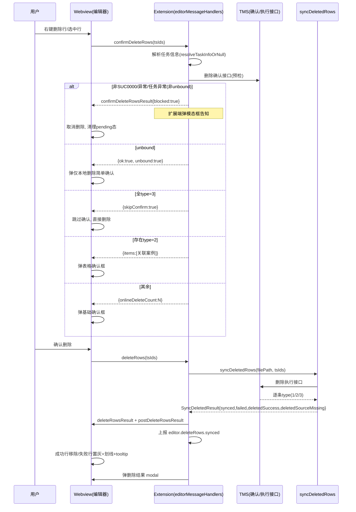
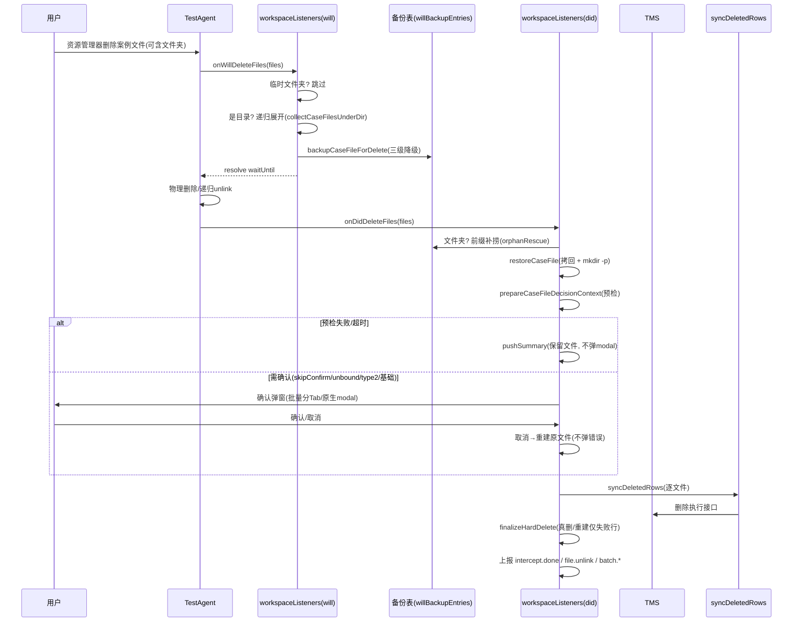
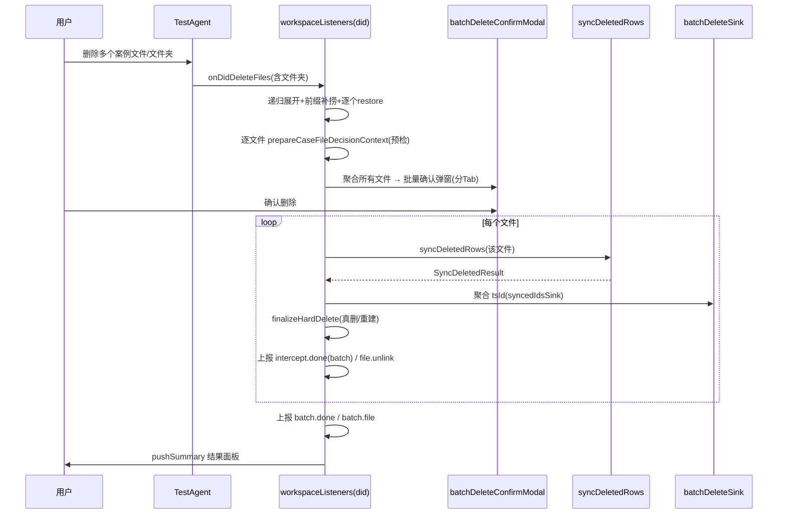
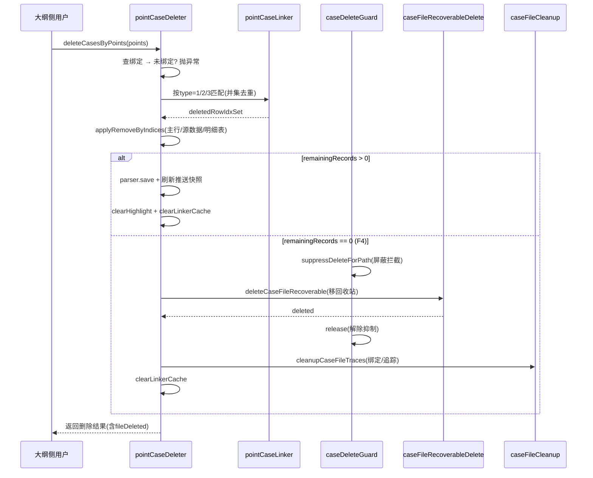

# 删除案例功能设计文档

> 适用视角：架构 / 实现（研发、代码评审、后续维护）
> 配套文档：需求文档 `docs/requirements/删除案例功能需求.md`、埋点契约 `docs/specs/埋点事件清单.md`
> 说明：本文档描述"系统如何设计以满足需求"，覆盖设计目标、术语约束、模块职责与每个功能的详细设计（关键流程扭转、时序图）。字段名、事件名均以**代码实现**为准。

---

## 1. 设计目标与范围

### 1.1 背景
测试案例维护在「测试任务 / <任务> / 测试案例」目录体系下，案例经推送后已在 TMS 平台落库，并可能关联**执行记录**与**缺陷记录**。当用户删除一条案例时，不能只删本地文件——否则 TMS 平台会残留"孤儿案例"，且执行/缺陷关联无法释放。

### 1.2 设计目标
1. **语义一致**：删本地与删线上结果一致（同步删除 TMS 案例及其执行/缺陷关联）。
2. **结果可观测**：每个删除动作都有"发起→结果"埋点闭环、有反馈界面、失败可下钻定位。
3. **失败可兜底**：预检失败、接口异常、未绑定任务等任何非致命错误都**降级继续**而非中止；取消即完整还原，绝不丢数据。
4. **可恢复**：因"要点删除"导致案例文件被清空时，整体删除走操作系统回收站，与资源管理器直接删除一致、可找回。
5. **安全不阻断**：任何异常都不静默、也不阻断用户正常的删除/文件操作。

### 1.3 范围
**覆盖三条删除入口**（即本文档的三大功能模块）：
- **编辑器内删除**：webview 内右键"删除该行 / 删除选中行"，作用于"已推送的具体案例行"。
- **文件删除拦截**：资源管理器删除整个案例文件（单文件 / 多文件 / 含案例文件的文件夹），在物理删除前拦截同步。
- **要点删除**：测试大纲侧删除某测试要点时，把其绑定案例文件中的关联案例行移除（由要点侧触发）。

**不在范围内**：
- TMS 平台内部的执行/缺陷释放逻辑（由后端负责）。
- 纯前端表格行的"视觉移除"本身（本文档关注其背后的本地落盘 + 线上同步语义）。
- 详细遥测字段契约（见 `docs/specs/埋点事件清单.md`，本文档仅给出事件清单与设计约束）。

### 1.4 设计原则
- **单一执行原语**：三条入口最终都收敛到 `deletedRowsStore.syncDeletedRows` → `http.deleteTestCase`，避免三套同步逻辑漂移。
- **两阶段拦截（will/did）**：文件删除依赖 TestAgent 异步事件，采用"will 阶段备份 + did 阶段决策/还原"模式，而非"抛异常中止删除"（异常会被 TestAgent 静默吞掉，无法真正阻止物理删除）。
- **解耦与抑制**：要点删除的整体删除通过 `caseDeleteGuard` 抑制开关屏蔽工作区拦截，避免"删完又触发拦截"的二次处理。
- **不阻断 + 可降级**：预检/执行异常一律降级继续；致命异常（重建失败）才显式告知。
- **脱敏**：所有 `filePath` 字段仅传 basename；`testcase_id` 经 `|` 拼接且超 8000 字符就近截断。

---

## 2. 术语与核心约束

### 2.1 术语
| 术语 | 含义 |
|------|------|
| `testcase_id`（tsId / sourceId） | 案例在 TMS 平台的唯一标识，是线上删除接口的入参主键 |
| 已推送案例 | `testcase_id` 非空且非样例占位，删时需同步线上 |
| 本地未推送行 | `testcase_id` 为空，仅本地存在，删时不调接口 |
| 样例占位 | 模板内置示例行的标识列（如"案例唯一标识，不可修改"），非空但非真实标识，不触发线上删除 |
| `type=1` | 线上删除成功（sourceId 真实存在并已删除） |
| `type=2` | 线上删除失败（存在关联阻止，如未关闭的执行/缺陷），需保留本地行 |
| `type=3` | sourceId 在平台不存在，按需求仍视为"删除成功"（本地清理），仅作汇总口径区分 |
| 删除确认接口（预检） | 删除前调用的"删除确认 / 预检"接口，返回每待删案例的关联信息（type、是否有执行/缺陷、来源） |
| 删除执行接口 | 真正执行线上删除的接口，返回逐条 `type` 结果 |
| `onlineDeleteCount` | 本次实际会调用 TMS 删除接口的行数 = 预检返回 `type=1 + type=2` 之和（本地未推送、样例占位、type=3 均不计入） |
| `hardDeleteOnly` | 批量场景中被判定"无需线上操作"的文件（无标识列 / 全部空 / 仅样例 / 空文件） |
| `skipConfirm` | 预检回包**全部为 type=3** 时跳过确认界面、直接删除 |
| `unbound` | 案例文件未绑定测试任务，无法调用线上接口，仅本地删除 |
| `blocked` | 预检非 `SUC0000` / 接口异常 / 任务信息获取异常（非未绑定）→ 编辑器内删除被阻断 |
| 临时文件夹 | 路径中任一目录段精确等于"临时文件"，其下的案例文件不识别、删除不拦截 |
| 明细表（detailTables） | 案例文件中主行之外的子表数据（如步骤明细），按索引与主行关联 |
| `pushSummary` | 复用的批量结果汇总面板，删除结果统一回显 |

### 2.2 核心约束
1. **脱敏约束**：所有 `filePath` 字段仅含文件名（basename），绝不携带目录/绝对路径。
2. **type 语义约束**：`type=1`/`type=3` 计入成功（后者口径单独区分）；仅 `type=2` 计入失败；未返回某 sourceId 结果时保守按失败（提示"接口未返回该 sourceId"）。
3. **`onlineDeleteCount` 口径**：所有确认弹窗首段红字数字必须用 `type=1 + type=2`，不得混入本地行或 type=3。
4. **确认表格列结构统一**：`| # | 编号 | 名称 | 执行 | 缺陷 | 来源 |` 三入口硬一致；`#` 仅前端序号、不进后端逻辑；`来源` 仅展示。
5. **两阶段拦截约束**：will 阶段只做备份与递归展开，did 阶段才做预检与决策；TestAgent 异步事件异常会被吞，故用"先放行 + 已删除阶段重建"而非"抛异常中止"。
6. **不阻断原则**：非致命错误降级继续；仅致命异常（如重建失败）显式告知。
7. **截断约束**：tsId 明细列表超 8000 字符就近截断为 `id1|id2|...(+N more)`，并附加 `<field>Truncated='true'` 标记，`Count` 字段始终保留真实条数。
8. **抑制约束**：`caseDeleteGuard` 抑制期间，受抑制路径在 will/did 处理器中被提前跳过，避免要点删除的整体删除被二次拦截。

---

## 3. 总体结构与模块职责

### 3.1 分层结构

```
┌─────────────────────────────────────────────────────────────┐
│  入口层（触发源）                                              │
│   webview(编辑器右键) │ TestAgent 资源管理器 │ 测试大纲/要点侧   │
└───────┬───────────────────────┬───────────────────┬────────┘
        │                       │                   │
┌───────▼──────────┐  ┌─────────▼──────────┐  ┌─────▼──────────────┐
│ editorMessage    │  │ workspaceListeners │  │ pointCaseDeleter   │
│ Handlers         │  │ (will/did 两阶段)  │  │ (要点删除编排)      │
│ 编辑器内删除编排  │  │ 文件删除拦截编排    │  │ 绑定/匹配/剔除/F4   │
└───────┬──────────┘  └─────────┬──────────┘  └─────┬──────────────┘
        │                       │                   │
        └───────────┬───────────┴─────────┬─────────┘
                    ▼                     ▼
        ┌───────────────────────┐   ┌────────────────────────┐
        │ deletedRowsStore      │   │ caseFileRecoverable     │
        │ syncDeletedRows       │   │ Delete (回收站删除)      │
        │ (共享执行原语)         │   └────────────────────────┘
        └───────────┬───────────┘
                    ▼
        ┌───────────────────────┐
        │ services/http.ts      │  deleteTestCase / 删除确认接口
        │ (TMS 接口封装)         │
        └───────────────────────┘

基础设施层（跨入口复用）：
  caseDeleteGuard │ batchDeleteSink │ batchDeleteConfirmModal │ deleteConfirmModal
  deleteResultModal │ deleteFeedback │ telemetryProps │ caseFileCleanup │ restoreCaseFile
```

### 3.2 模块职责表

| 模块（文件） | 层级 | 职责 |
|---|---|---|
| `handlers/workspaceListeners.ts` | 文件删除入口/编排 | 注册 `onWillDeleteFiles`/`onDidDeleteFiles`；will 阶段备份 + 文件夹递归展开；did 阶段还原 + 前缀补捞 + 批量决策；批量汇总与 `batch.done`/`batch.file` 上报 |
| `handlers/editorMessageHandlers.ts` | 编辑器内删除入口 | 处理 `confirmDeleteRows`（预检裁决）与 `deleteRows`（执行）；前置 blocked/unbound/skipConfirm 裁决；调用 `syncDeletedRows` 并回传前端 |
| `handlers/deletedRowsHandler.ts` | 命令式同步删除 | 处理"同步已删除行"命令（`syncDeletedRows`），无文件打开时降级 toast |
| `utils/pointCaseDeleter.ts` | 要点删除编排 | 查绑定→关联匹配（type=1/2/3 并集去重）→剔除主行/源数据/明细表→落盘/清空后 F4 整体删除 |
| `utils/pointCaseLinker.ts` | 关联匹配引擎 | 要点-案例关联匹配（父级标识 / 路径归一化），带内存缓存 |
| `utils/deletedRowsStore.ts` | 共享执行原语 | 已删除行追踪存储；`syncDeletedRows(filePath, tsIds)` 统一调用 TMS 删除执行接口并返回 `SyncDeletedResult` |
| `services/http.ts` | 接口封装 | `deleteTestCase`（执行接口）、删除确认接口封装 |
| `utils/caseFileRecoverableDelete.ts` | 可恢复删除 | 把案例文件移到 OS 回收站（复用 `Move to Trash`），不可用时降级物理 `unlink` |
| `utils/caseDeleteGuard.ts` | 抑制开关 | 路径级 Set，临时屏蔽工作区删除拦截（`suppressDeleteForPath`/`isDeleteSuppressed`） |
| `utils/batchDeleteSink.ts` | 批量聚合 | `syncedIdsSink` / `snapshotFiles` 聚合整批 tsId 与逐文件明细（供 `batch.done`/`batch.file`） |
| `utils/batchDeleteConfirmModal.ts` | 批量 UI | 批量确认弹窗（分 Tab、header 口径、风险卡） |
| `utils/deleteConfirmModal.ts` / `deleteResultModal.ts` | 单文件 UI | 单文件确认弹窗 / 结果汇总 modal |
| `utils/deleteFeedback.ts` | 反馈构建 | 失败明细、结果 modal、postMessage 回传 |
| `utils/telemetryProps.ts` | 遥测构造 | `caseDeletionTelemetryProps` / `syncDeletedResultTelemetryProps` / `telemetryTsIdListProps`（全场景一致命名） |
| `utils/caseFileCleanup.ts` | 追踪清理 | 清理文件的高亮/快照/绑定库引用（文件删除成功或要点清空后调用） |

### 3.3 关键共享数据结构
- **`SyncDeletedResult`**（删除执行结果，三入口共用）：
  `{ synced: string[]; failed: {tsId,reason}[]; deletedSuccess: string[]; deletedSourceMissing: string[]; localOnly?: boolean }`
  - `synced` = type=1 + type=3；`deletedSuccess` = type=1；`deletedSourceMissing` = type=3。
- **`WillBackupEntry`**（will 备份表条目）：含 `filePath`、`fileName`、`wasOpen`、备份产物路径、解析结果等；`willBackupEntries` 为以绝对路径为键的表。
- **`caseDeletionTelemetryProps` 输出**：`deletedFilePath` / `deletedTestcaseIds[Count|Truncated]` / `deletedSuccessTestcaseIds[Count]` / `deletedSourceMissingTestcaseIds[Count]`（全场景统一）。

---

## 4. 各功能详细设计

### 4.1 编辑器内删除（同步删除 TMS 平台案例）

#### 4.1.1 触发与分流
webview 内右键"删除该行 / 删除选中行" → 前端先判定是否含"已推送案例"（标识列非空且非样例占位）：
- 仅本地未推送行 → 仅本地物理删除、不调接口、不弹确认。
- 含已推送案例 → 上报标识列表 + 当前表格标识有序快照（供失败行计算"删除后视图行号"），进入预检→确认→执行。

#### 4.1.2 关键流程扭转
1. 前端发 `confirmDeleteRows(tsIds)` → `handleConfirmDeleteRows`：解析任务信息 → 调删除确认接口（预检）。
2. **裁决优先级**（在 `confirmDeleteRowsResult` 返回前统一计算）：
   - **blocked**：预检非 `SUC0000` / 接口异常 / 任务信息异常（非未绑定）→ 返回 `blocked:true`，扩展端弹模态框，前端取消删除并清 pending。
   - **unbound**：返回 `ok:true, unbound:true` → 前端弹"仅本地删除"简单确认。
   - **skipConfirm**：回包全部为 `type=3`（`Number(type)===3`，且 body 非空）→ 跳过确认。
   - **type=2 存在** → 返回 `items` 表格数据，前端弹表格确认。
   - **其余** → 返回 `onlineDeleteCount`，前端弹基础确认。
3. 用户确认后前端发 `deleteRows(tsIds)` → `handleDeleteRows`：调用 `syncDeletedRows(filePath, tsIds)` → `postDeleteRowsResult` 回传表格 + 弹结果 modal + 上报 `editor.deleteRows.synced`。

#### 4.1.3 时序图


#### 4.1.4 异常决策树
| 场景 | 决策 | 用户感知 |
|---|---|---|
| 预检非 SUC0000 / 任务信息异常 | `blocked`，取消删除 | 扩展端模态框 |
| 预检接口抛错/超时 | `blocked` | 同上；前端 90s 超时另弹「重试/取消」 |
| unbound | 仅本地删除 | 简单确认导语区分 |
| 执行 type=2 | 该行失败保留 | 置灰+划线+tooltip |
| 执行整体异常 | 全部标记失败 | 汇总 modal 展示原因 |
| 全 type=3 | skipConfirm | 无确认框，结果照常 |

---

### 4.2 文件删除拦截（按行级结果决定删文件或保留失败行）

#### 4.2.1 两阶段拦截模型
依赖 TestAgent 的 `onWillDeleteFiles` / `onDidDeleteFiles` 两个异步事件：
- **will 阶段**：用事件的 `waitUntil` 挂起删除，同步备份每个案例文件（含文件夹递归展开），随后放行。
- **did 阶段**：文件已被 TestAgent 物理删除，此处从备份拷回（`restoreCaseFile`），再预检、决策、按结果真删或重建。

> 为何不直接抛异常中止删除？TestAgent 异步事件发射器以"等待所有挂起 Promise 完成"收口，拦截器抛出的异常只会被静默吞掉为未处理错误，**不会真正中止物理删除**。因此采用"先放行 + did 阶段重建"模式。

#### 4.2.2 备份三级降级（保证"取消即可完整还原"）
1. **一级（字节级）**：`fs.copyFileSync` 到 `os.tmpdir`（99%+ 命中，保留注释/空行/字段顺序），上报 `caseFileDelete.backup.*` 相关埋点。
2. **二级（内容级）**：一级失败 → `parser.stringify + fs.writeFileSync`（结构完整，损失注释/顺序）。
3. **三级（内存快照）**：序列化仍失败 → 仅保留内存 `restoreTableData/restoreSourceData`，did 阶段用 `parser.save` 兜底重建。

#### 4.2.3 文件夹递归展开 + 前缀补捞
- will 阶段遇目录 URI：同步递归扫描其子案例文件（`collectCaseFilesUnderDir`），逐个进入备份（`caseFileDelete.folder.expand`）。
- did 阶段 `event.files` 仅含文件夹 URI：以「文件夹路径 + sep」为前缀从备份表补捞孤儿条目（`caseFileDelete.folder.orphanRescue`），再统一决策。
- 拷回时若父目录已被递归 unlink，先 `mkdir -p` 重建目录树再 `copyFile`（防 `ENOENT`）。

#### 4.2.4 决策上下文与按行分派
- `prepareCaseFileDecisionContext(entry)`：还原后重新 parse，调删除确认接口（预检），分类为 `precheckFailed` / `unbound` / `skipConfirm` / `needConfirm(type2表格)` / `hardDeleteOnly` 等。
- 预检失败/超时（L1 90s socket + L2 100s 硬超时）：**不弹原生 modal**，改走 `pushSummary` 汇总（与批量 `allPrecheckFailed` 一致），文件保留不删。
- `finalizeCaseFileAfterUserConfirm(ctx)`：执行 `syncDeletedRows` → 全成功则 `finalizeHardDelete(mode='afterSync')` 真删并清理本地缓存；部分/失败则重建"仅失败行"版本并 reopen（若 `wasOpen`）渲染高亮。

#### 4.2.5 时序图


#### 4.2.6 取消与临时文件夹
- 用户取消/ESC/关闭 → `restoreCaseFile` 拷回原内容，**不弹任何"删除失败"modal**（取消≠错误）。
- 临时文件夹（`路径含目录段精确 == "临时文件"`）下的案例文件：will 阶段即跳过备份/预检/确认，`caseDeleteGuard` 不参与（纯 TestAgent 直删）。

---

### 4.3 批量 / 文件夹删除

#### 4.3.1 聚合与确认
- 多文件 / 含案例文件的文件夹删除 → 聚合到**批量确认弹窗**（每个文件一个 Tab；tab 标题与 pane header 显示相对工作区完整路径以区分同名文件）。
- header 口径：`删除案例 — 共 N 个文件（M 需同步 TMS·K 案例 / P 仅本地 / R 仅本地清理(type=3) / Q 跳过）`，恒等式 `N = M+P+R+Q`。
- `hardDeleteOnly` 文件：仅在弹窗中展示（pane 提示"仅删除本地文件（共 X 行）"），确认后绕过预检直接放行。

#### 4.3.2 汇总与逐文件遥测
`handleCaseFilesDidDelete` 处理完所有文件后：
- 逐文件：`caseFileDelete.intercept.done`（`batch='true'`）。
- 整批汇总：`caseFileDelete.batch.done`（文件维度 + tsId 维度 + 明细，经 `batchSyncedTotal` 等聚合，明细走 `caseDeletionTelemetryProps`）。
- 逐文件明细：`caseFileDelete.batch.file`（含预检失败文件 `unlinkResult='skipped'`，保证批量文件清单可回放）。
- 实际物理删除：`finalizeHardDelete` 内每次 unlink 上报 `caseFileDelete.file.unlink`（成功/ENOENT/失败）。

#### 4.3.3 时序图（批量）


---

### 4.4 要点删除（从本地案例文件移除关联行）

#### 4.4.1 匹配与剔除
1. 按 `pointFilePath` 查绑定得到关联案例文件；未绑定则抛异常（由调用方提示）。
2. 复用要点-案例关联匹配引擎（与"查看关联案例"一致）：`type=1`（父级标识命中且路径归一化相等）/ `type=2`（仅路径相等）/ `type=3`（仅父级标识命中）；`pointName` 不参与匹配。
3. 多要点**并集**去重：命中任一要点即删，同一案例只剔除一次。
4. `applyRemoveByIndices` 按主行索引同步剔除主表行、源数据、明细表行。

#### 4.4.2 F4：清空后整体可恢复删除
若删除后 `remainingRecords === 0`：**不保留空文件**，调用 `deleteCaseFileRecoverable` 把整个文件移到 OS 回收站（复用 `vscode.workspace.fs.delete({useTrash:true})`），回收站不可用时降级物理 `unlink`；随后统一 `cleanupCaseFileTraces` 清理该文件全部追踪态存储（高亮/快照/绑定库引用）并 `clearLinkerCache`。该整体删除通过 `caseDeleteGuard.suppressDeleteForPath` 临时屏蔽工作区拦截（避免被备份→还原→弹确认二次处理），其间任意异常被吞掉并上报 `caseFileRecoverableDelete.unlinkFailed`，绝不阻断主流程。

#### 4.4.3 时序图


---

### 4.5 共享执行原语：`syncDeletedRows`
三入口最终都调用 `deletedRowsStore.syncDeletedRows(filePath, tsIds)`：
- 读取已删除行追踪存储，逐条调用 `http.deleteTestCase`（TMS 删除执行接口）。
- 按返回 `type` 分桶：`synced`（1+3）、`failed`（2 及未返回）、`deletedSuccess`（1）、`deletedSourceMissing`（3）。
- 成功后清除追踪记录与快照；返回 `SyncDeletedResult` 供上层反馈与遥测。
- 遥测字段统一经 `syncDeletedResultTelemetryProps` → `caseDeletionTelemetryProps` 构造，保证全场景命名一致。

---

### 4.6 结果反馈与失败兜底
- **编辑器内删除**：表格内行状态（成功移除 / 失败置灰+划线+tooltip）+ 删除结果 modal。
- **单文件 / 批量 / 文件夹删除**：统一走 `pushSummary` 批量结果面板（含预检失败、可点击定位）。
- **口径收敛**：单文件与批量统一 `pushSummary`；仅编辑器内删除保留 modal（位于表格视图上下文）。
- **顶层不阻断**：`onDidDeleteFiles` 以 fire-and-forget 触发，顶层 catch 记录日志 + 上报 `caseFileDelete.did.uncaught`；`finalizeHardDelete` 真实 unlink 失败（非 ENOENT）向上抛出并被捕获。

---

### 4.7 遥测设计
- **统一字段构造器**：`telemetryTsIdListProps` 负责 `join → 8000 截断 → <key>Count → <key>Truncated`；`caseDeletionTelemetryProps` 封装 `deletedTestcaseIds` / `deletedSuccessTestcaseIds` / `deletedSourceMissingTestcaseIds` 三档（**注意：这是真正发往遥测通道的 prop 名**，与内部 JS 对象字段 `syncedTsIds` 等区分）。
- **事件清单（按场景分组）**：
  - 编辑器内：`editor.deleteRows.init` / `.synced` / `.error`。
  - 命令式：`syncDeletedRows.aborted` / `.noPending` / `.complete` / `.error`。
  - 文件删除：`caseFileDelete.intercept.init` / `.intercept.done` / `.userCancel` / `.file.unlink` / `.batch.done` / `.batch.file` / `.reopen` / `.did.uncaught` / `.decision.error` / `.decision.timeout` / `.folder.expand` / `.folder.orphanRescue` / `.backup.uncaught` / `.backup.copyFileFailed` / `.backup.serializeFailed` / `.skipped.notTestCaseFile` / `.restore.failed` / `.restore.done` / `.restore.giveup`。
  - 可恢复删除：`caseFileRecoverableDelete.unlinkFailed`。
  - 要点绑定：`pointCaseBindings.rename.synced/.error` / `pointCaseBindings.delete.synced/.error`。
  - 完整契约见 `docs/specs/埋点事件清单.md`。

---

## 5. 关键流程扭转汇总（决策状态机）

```
                         ┌─────────────────────────────────────┐
                         │          删除发起 (三入口)            │
                         └───────────────┬─────────────────────┘
                                         │
              ┌──────────────────────────┼──────────────────────────┐
              ▼                          ▼                          ▼
      编辑器内删除(-webview)      文件删除(will/did)          要点删除(大纲侧)
              │                          │                          │
              │  confirmDeleteRows       │  will:备份+递归展开        │ 查绑定+匹配(type1/2/3并集)
              ▼                          ▼                          │
      预检裁决                      did:还原+前缀补捞           剔除主行/源/明细
      ┌───┬───┬───┬───┐              预检裁决                    │
      │blk│unb│skp│t2 │               ┌───┬───┬───┬───┬────┐     ├── remaining>0 → 落盘+清理
      └───┴───┴───┴───┘               │pf │unb│skp│t2 │hdOnly│     └── remaining==0(F4)
        │     │   │   │                └───┴───┴───┴───┴────┘            │
        ▼     ▼   ▼   ▼                  │     │   │   │   │          suppressDeleteForPath
    取消/  仅本地 跳过 表格/           保留  仅本地 跳过 表格/ hardDel   │
    弹modal 删除  确认 基础确认         文件  删除  确认 基础   直接放行  ▼
        │     │   │   │                  │     │   │   │   │      deleteCaseFileRecoverable(回收站)
        └─────┴─┬─┴───┘                  └─────┴─┬─┴───┴───┘            │
               │                              │                      cleanupCaseFileTraces
               ▼                              ▼                      release抑制
        syncDeletedRows (共享执行原语)   syncDeletedRows            └─▶ 返回结果
               │                              │
               ▼                              ▼
        SyncDeletedResult              finalizeHardDelete
               │                         (真删 / 重建仅失败行)
               ▼                              │
        反馈(行状态/modal)              file.unlink / intercept.done
               │                          batch.done / batch.file
               ▼                              │
        埋点(editor.deleteRows.*)            ▼
                                      pushSummary 反馈 + 埋点
```

> 设计要点：所有"是否调线上、是否弹确认、成功/失败如何分派"的判定，在三入口均收敛到同一套 `type`/`skipConfirm`/`unbound`/`hardDeleteOnly`/`precheckFailed` 分类逻辑；唯一的执行出口是 `syncDeletedRows`，唯一的物理删除出口是 `finalizeHardDelete` 与 `caseFileRecoverableDelete`。
