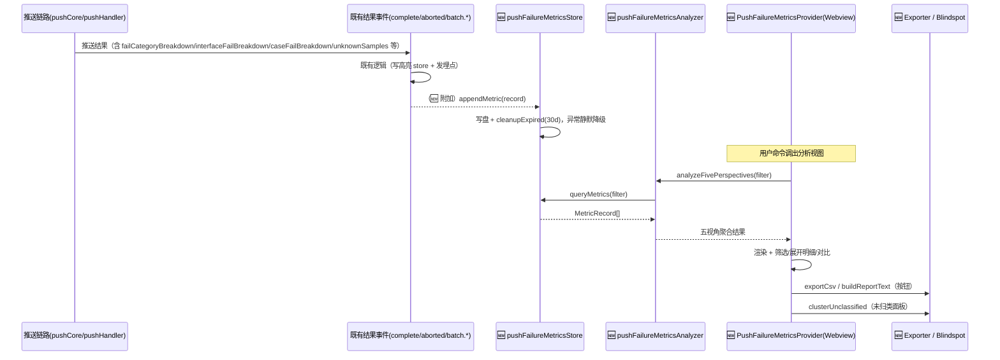

# 推送失败案例报错数据度量与统计分析 — 设计文档

> 🆕 **本功能为新增能力（New Feature）**
> 适用视角：架构 / 实现（研发、代码评审、后续维护）
> 配套文档：需求文档 `docs/requirements/push-failure-metrics-requirements.md`、分类契约 `docs/specs/推送失败度量说明.md`、埋点清单 `docs/specs/埋点事件清单.md`
> 字段名、事件名、分类码均以**当前代码实现**为准。

> 说明：本设计文档描述一项**全新引入的能力**，覆盖需求 §3.1~§3.5 全链路（采集 → 分类建模 → 持久化 → 分析 → 导出 → 补盲）。其中：分类建模层属于本功能范围、需设计（实现可复用既有 `pushFailure/categoryClassify.ts` / `fieldMapping.ts` 等基础，但不视为前置已完成项）；采集维度的结果事件上报、内存聚合等已有代码基础可复用；持久化 / 分析 / 导出 / 补盲层为全新建设。

---

## 1. 设计目标与范围

### 1.1 背景

案例经由本插件的推送链路送往后端，推送是一个多阶段、易出错的流程。现状是：

- **分类与聚合已有基础可复用**：既有 `pushFailure/categoryClassify.ts` 可把后端中文失败文案归类为 `category` / `field`，`pushFailure/aggregate.ts` 可在内存按 category / field 聚合；本功能把"分类建模"纳入自身范围统一设计，不视为前置已完成项。
- **失败维度上报已有埋点基础**：`explorerPush.complete` / `editorPush.complete` / `explorerPush.aborted` / `explorerPush.batch.*` 可携带 `failCategoryBreakdown` / `interfaceFailBreakdown` / `caseFailBreakdown` / `unknownSamples` 等维度（见 `docs/specs/推送失败度量说明.md` §5），本功能采集层复用这些既有埋点维度作为数据来源。
- **但缺少"度量分析闭环"**：失败后数据只进埋点（远端）、不落本地；用户/开发无法在插件内"看清一批失败的共性、按字段/来源/版本切片、展开明细、导出"。失败的运维与补盲无法在客户端闭环。

因此本需求**新增**一套"采集 → 分类 → 持久化 → 分析 → 导出 → 补盲"的本地度量能力，把散落的失败变成可归因、可反馈的数据资产。

### 1.2 设计目标

1. **失败可见全貌**：把历次推送失败本地沉淀，按"字段缺陷热点 / 接口级公共参数 / 来源平台 / 插件版本成功率 / 未知原因"五视角聚合。
2. **失败可分类、可展开明细**：建立稳定的失败分类与接口级/行级字段维度（可复用既有归类基础，不重复造轮子），中文原文仅展示、稳定短码仅统计，二者解耦。
3. **高频字段缺陷可感知**：行级字段失败聚合为热点榜，定位"哪类字段错最多"。
4. **来源 / 版本差异可量化**：按来源平台、插件版本切片失败率，支持两版本对比。
5. **未知报错可收敛**：本地聚类未归类原文，输出 Top 榜单，反哺分类规则表。
6. **结果可出口**：支持导出 CSV / 复制文本报告，作为失败规律的客观依据对外反馈。

### 1.3 范围

**本功能覆盖需求 §3.1~§3.5 全链路**（采集 → 分类建模 → 持久化 → 分析 → 导出 → 补盲），各层均为本功能范围：

- **采集层**：在推送结果事件中产出失败分类 / 接口级 / 行级字段 / 未归类等维度，并附加写入本地度量存储。
  - 失败维度随结果事件上报：复用既有已上线的埋点维度（`failCategoryBreakdown` / `interfaceFailBreakdown` / `caseFailBreakdown` / `unknownSamples` 等）。
  - 本地结构化存储：新增。
- **分类建模层（本功能范围，需设计）**：把后端中文失败文案稳定归类为"失败分类 + 接口级/行级字段"两个正交维度。实现以既有 `pushFailure/categoryClassify.ts`、`fieldMapping.ts` 为基础扩展（新增后端错误类型只需加一条规则），但本设计文档将其纳入功能整体，不视为前置已完成项。
- **持久化层（新增）**：本地结构化存储每次推送失败记录，按 30 天滚动，读写异常静默降级。
- **分析层（新增）**：插件内分析命令读取存储，做五视角聚合，渲染分析视图。
- **导出层（新增）**：CSV 导出 + 文本报告复制。
- **补盲层（新增）**：未归类原文本地聚类，输出高频榜单 + 建议归属。

**实现可复用的既有基础（非功能范围，仅为实现底座）**：
- `pushFailure/categoryClassify.ts`、`fieldMapping.ts`、`aggregate.ts`：分类与字段抽取、内存聚合工具，供分类建模层 / 分析层复用与扩展。
- `telemetry.ts`：既有埋点发送；本功能只读其产出的维度，不改远端契约。
- `pushFailureStore.ts`：失败高亮存储；本功能不写，仅读既有分类结果。

### 1.4 设计原则

- **复用优先**：分类建模层复用并扩展既有 `src/utils/pushFailure/*` 基础（不重复造轮子），新增错误类型只需在归类规则表加一条规则。
- **不阻塞推送**：写入度量存储是推送结果处理的"附加副作用"，异常全部静默降级，绝不影响推送主流程与既有高亮。
- **解耦分层**：采集只产数据、分析只消费、补盲只扩展映射；存储结构稳定，新增分类只需在既有映射表加一行。
- **中文原文与短码解耦**：存储里同时保留 `category`/`field`（统计用）与 `reason`（展示/补盲用），但聚合只用短码。
- **本地闭环、边界清晰**：报告导出仅提供能力，不自动回传（超出插件边界）。

---

## 2. 术语与核心约束

### 2.1 术语

| 术语 | 含义 |
|---|---|
| `category` | 失败大类稳定短码（`network`/`auth`/字段复合码 `字段.性质`/`unknown` 等），统计聚合用，来自既有 `pushFailureCategory.ts` |
| `field` | 命中的接口字段码（`testTaskNo`/`designer`/`description`/`expected` 等），与 `category` 正交，来自 `fieldMapping.ts` |
| `level` | 字段级别：`interface`（接口级公共参数，一次错=整批失败）/ `case`（行级字段，每行独立） |
| 已推送案例 | `testcase_id` 非空且已成功推送（有 `testCaseNo`）的案例 |
| 未归类原文 | `category === 'unknown'` 或无法抽取 `field` 的失败 reason 原文，用于补盲 |
| 度量记录（MetricRecord） | 一次推送结果的本地结构化失败快照 |
| 五视角聚合 | 字段缺陷热点 / 接口级公共参数 / 来源平台 / 插件版本成功率 / 未知原因 |
| 30 天滚动 | 存储仅保留近 30 天推送记录，超期自动清理，不无限增长 |

### 2.2 核心约束

1. **不重复分类**：度量记录里的 `category`/`field` 直接取自既有分类器的输出，新增代码不重新归类。
2. **不改远端契约**：既有 `*.complete`/`*.aborted`/`batch.*` 维度保持原样；本功能只在扩展端"监听"这些结果事件并落本地存储。
3. **采集不阻塞**：写入度量存储失败（I/O/权限/磁盘满）时静默降级，不弹错、不影响推送结果与高亮持久化（`pushFailureStore.ts`）。
4. **原文截断**：未归类原文样本单条截断至 200 字（与既有 `unknownSamples` 截断口径一致），控制存储体积。
5. **聚合稳定性**：五视角聚合只基于 `category`/`field`/`sourcePlatform`/`extVersion` 等稳定短码，不基于中文 reason 聚合。
6. **来源/版本维度口径**：`sourcePlatform` 取自推送时的来源平台判定；`extVersion` 取 `vscode.extensions.getExtension(本插件).packageJSON.version`，保证版本切片准确。
7. **存储滚动**：`pushTime < now - 30d` 的记录在读取/写入时异步清理，孤儿文件（已被删除的案例文件）对应记录保留原样（度量按记录而非按文件）。

---

## 3. 总体结构与模块职责

### 3.1 分层结构

```
┌──────────────────────────────────────────────────────────────────┐
│  采集层（推送结果事件，既有埋点维度 + 附加本地落盘）                  │
│   explorerPush.complete / editorPush.complete / *.aborted /       │
│   explorerPush.batch.fileResult / explorerPush.batch.done        │
└───────────────────────────┬──────────────────────────────────────┘
                            │ 结果事件携带 failCategoryBreakdown /
                            │ interfaceFailBreakdown / caseFailBreakdown /
                            │ unknownSamples / sourcePlatform / 等
                            ▼
┌──────────────────────────────────────────────────────────────────┐
│  🆕 分类建模层（本功能范围，需设计）                                │
│   pushFailure/categoryClassify.ts / fieldMapping.ts（复用并扩展）   │
│   中文失败文案 → 稳定 分类 + 接口级/行级字段 短码（中文原文解耦）    │
└───────────────────────────┬──────────────────────────────────────┘
                            ▼
┌──────────────────────────────────────────────────────────────────┐
│  🆕 持久化层（新增模块）                                          │
│   pushFailureMetricsStore.ts                                      │
│   每次推送结果 → 构造 MetricRecord → 写入本地 JSON（30 天滚动）    │
└───────────────────────────┬──────────────────────────────────────┘
                            ▼
┌──────────────────────────────────────────────────────────────────┐
│  🆕 分析层（新增模块）                                            │
│   pushFailureMetricsAnalyzer.ts                                   │
│   读存储 → 五视角聚合 → 筛选/展开明细/对比 → 产出分析视图数据         │
└───────────┬───────────────────────────────┬──────────────────────┘
            ▼                               ▼
┌──────────────────────┐      ┌─────────────────────────────────────┐
│ 🆕 分析视图(Webview)  │      │ 🆕 导出层（新增模块）                │
│ 命令调出,可排序/展开明细  │      │ pushFailureMetricsExporter.ts         │
└──────────────────────┘      │ 导出 CSV / 复制文本报告              │
            │                  └─────────────────────────────────────┘
            ▼
┌──────────────────────────────────────────────────────────────────┐
│  🆕 补盲层（新增模块）                                            │
│   pushFailureMetricsBlindspot.ts                                  │
│   未归类原文本地聚类 → Top 榜单 + 建议归属分类                     │
└──────────────────────────────────────────────────────────────────┘

实现底座（复用既有，不新增，非功能范围）：
  pushFailureStore.ts(高亮) │ telemetry.ts(既有埋点，只读不写契约)
```

### 3.2 模块职责表

| 模块（文件，🆕 为新增） | 层级 | 职责 |
|---|---|---|
| `handlers/pushCore.ts` / `pushHandler.ts`（既有） | 采集入口 | 推送结果事件处**新增附加调用**：把本次失败维度喂给度量存储写入 |
| `utils/pushFailure/categoryClassify.ts`、`fieldMapping.ts`（既有基础，本功能纳入设计） | 分类建模层 | 把中文失败文案归类为 分类 + 接口级/行级字段 稳定短码；复用既有基础并据本功能需要扩展（新增错误类型只需加规则） |
| 🆕 `utils/pushFailureMetricsStore.ts` | 持久化层 | 本地结构化存储每次推送失败记录；`appendMetric` / `queryMetrics` / `cleanupExpired`；30 天滚动；异常降级 |
| 🆕 `utils/pushFailureMetricsAnalyzer.ts` | 分析层 | 读存储做五视角聚合；`analyzeFivePerspectives(filter)` / `drillDown(field, limit)` / `compareVersions(vA, vB)` |
| 🆕 `utils/pushFailureMetricsExporter.ts` | 导出层 | `exportCsv(analysis)` 生成 CSV 文本；`buildReportText(analysis)` 生成纯文本报告 |
| 🆕 `utils/pushFailureMetricsBlindspot.ts` | 补盲层 | `clusterUnclassified(metrics)` 对未归类原文去重计数，输出 Top10 + 建议归属分类草拟 |
| 🆕 `providers/PushFailureMetricsProvider.ts` | 视图层 | 新增 Webview panel，渲染分析视图（排序/筛选/展开明细/对比/导出按钮） |
| 🆕 `commands.ts`（新增命令注册） | 入口 | 注册 `testcaseViewer.pushFailureMetrics.show`（调出分析视图）、`testcaseViewer.pushFailureMetrics.exportCsv`、`testcaseViewer.pushFailureMetrics.copyReport` |

### 3.3 关键共享数据结构（🆕 新增）

**`MetricRecord`**（一次推送结果的本地结构化失败快照）：

```ts
interface MetricRecord {
  /** 推送链路追踪号（来自既有 traceId） */
  traceId: string;
  /** 文件绝对路径（用于展开失败文件列表明细） */
  filePath: string;
  /** 文件名（basename，脱敏，不存目录） */
  fileName: string;
  /** 文件类型（yaml / csv / xlsx） */
  fileType: string;
  /** 来源平台（TMS / RFWeb / 手工） */
  sourcePlatform: string;
  /** 插件版本（packageJSON.version），用于版本切片 */
  extVersion: string;
  /** 推送发生时间（ms） */
  pushTime: number;
  /** 行级计数 */
  totalRows: number;
  failedRows: number;
  successRows: number;
  /** 失败分类分布：category -> 行数 */
  failCategoryBreakdown: Record<string, number>;
  /** 接口级公共参数失败分布：field -> 行数（level='interface'） */
  interfaceFailBreakdown: Record<string, number>;
  /** 行级字段失败分布：field -> 行数（level='case'） */
  caseFailBreakdown: Record<string, number>;
  /** 未归类原文样本（reason 原文，单条截断 200 字，去重） */
  unclassifiedSamples: string[];
  /** 是否前置拦截（语法/样例等，未进 runPush） */
  isPreCheckBlocked: boolean;
}
```

> 注：以上所有 `Breakdown` 字段的值与既有 `*.complete` 事件的同名维度**同口径**，可直接从结果事件 props 透传，无需重新计算。

**存储文件**：`globalStorageUri/push-failure-metrics.json`，形式为 `MetricRecord[]`（数组便于时间窗过滤与滚动清理）。

---

## 4. 各功能详细设计

### 4.1 分类建模层（本功能范围，需设计）

把后端返回的自由中文失败文案，稳定归类为"失败分类"与"接口级/行级字段"两个正交维度，既保留中文原文供展示，又产出稳定短码供聚合统计。本层属于本功能范围、需设计；实现以既有 `pushFailure/categoryClassify.ts`、`fieldMapping.ts` 的基础能力为起点扩展，但不视为前置已完成项。

#### 4.1.1 分类维度与归类优先级

归类优先级：**先复用结构化信号，再走中文文本归类**（与需求 §3.2.1 一致）。

| 来源 | 分类 | 说明 |
|---|---|---|
| 预校验结构化信号 | 占位 / 空标识 / 样例 / 字段映射错误 等 | 客户端已明确，直接映射 |
| 后端中文文本（关键词） | 网络 / 鉴权 / 重复 / 字段非法 / 不存在 / 服务异常 / 业务拒绝 | 按关键词优先级归类 |
| 都不命中 | 未归类（`unknown`） | 兜底归类，不丢失败 |

#### 4.1.2 接口级 / 行级字段维度

从失败文案抽取命中的接口字段，并带级别（与需求 §3.2.2 一致）：

| 级别 | 含义 |
|---|---|
| 接口级（公共参数，一处出错整批失败） | 测试任务编号 / 子任务 / 产出物 / 来源平台 / 设计人 等请求体顶层或公共参数 |
| 行级（每行独立） | 案例标识 / 案例路径 / 案例名称 / 步骤描述 / 预期结果 / 优先级 / 类型 / 前置条件 / 关键案例 / 测试要点 / 步骤数量一致性 等单条案例字段 |

分层的目的是避免"设计人无权限"这类接口级一次错误，在计数维度淹没"步骤描述缺失"等行级字段的真实分布。

#### 4.1.3 设计要点

- 中文原文只作"展示"，分类/字段短码只作"统计"，二者解耦；
- 新增后端错误类型：只需在归类规则表加一条规则，不改持久化结构、不改采集字段（与补盲层闭环）；
- 复用并扩展既有 `pushFailure/categoryClassify.ts` / `fieldMapping.ts`：既有 `classifyFailure` / `classifyBackendFailure` / `extractInterfaceField` 等作为基础，本功能据需求补充接口级/行级分层与字段聚焦（如 `fieldLevelOf` / `auxiliaryFieldOf` / `failureFieldOf`）；
- 分类输出（`category` / `field` / `level`）是采集层构造成 `MetricRecord` 的输入，也是分析层五视角聚合的唯一稳定维度来源。

---

### 4.2 持久化层（🆕 新增）

#### 4.2.1 写入时机（附加、不阻塞）

在既有推送结果处理中**新增一次附加调用**（fire-and-forget，`try/catch` 全包裹）：

1. `explorerPush.complete` / `editorPush.complete`：单文件推送完，构造 `MetricRecord` 写入。
2. `explorerPush.batch.fileResult` / `explorerPush.batch.done`：逐文件 / 批次汇总，分别按文件粒度写入（避免重复计数——与既有"批量去重"口径一致：批量场景逐文件已带完整维度，批次汇总不再重复写每条文件记录，仅写 `batch.done` 一条汇总记录，或在 `fileResult` 已写时跳过 `done`）。
3. `*.aborted`（前置拦截类，如 `yamlSyntax`/`emptyFile`/`unbound`）：同样写一条 `isPreCheckBlocked=true` 的记录，满足需求 AC-1"含拦截类"。

构造 `MetricRecord` 所需字段**直接取自结果事件既有 props**（`failCategoryBreakdown` / `interfaceFailBreakdown` / `caseFailBreakdown` / `unknownSamples` 等），不重新归类、不重新聚合。

#### 4.2.2 关键流程扭转

```
推送结果事件 → handler 既有逻辑（写入高亮 store + 发埋点）
                └─（🆕 新增附加）buildMetricRecord(eventProps)
                                      └─ pushFailureMetricsStore.appendMetric(record)
                                            ├─ 读盘（mtime 缓存）→ 追加 → 写盘
                                            ├─ 异常 → console.warn + 静默降级
                                            └─ 写后异步 cleanupExpired(30d)
```

#### 4.2.3 存储接口

```ts
/** 追加一条度量记录（异步，异常静默降级） */
export async function appendMetric(record: MetricRecord): Promise<void>;

/** 按过滤条件查询记录（时间窗/来源/版本/文件）；空过滤=全部 */
export function queryMetrics(filter?: MetricFilter): MetricRecord[];

/** 清理超 30 天记录（写入后异步触发，也供 activate 时调用） */
export async function cleanupExpired(retentionMs?: number): Promise<void>;

/** 统计当前记录数（供分析视图展示"样本量"） */
export function countMetrics(): number;
```

设计要点（与 `pushFailureStore.ts` / `pushSnapshotStore.ts` 对齐的加载策略）：
- 使用 `mtime` 缓存，文件未变更直接返回缓存，避免跨实例读到旧数据。
- 全 `try/catch` 包裹，写失败不抛向上、仅 `console.warn`，不污染推送主流程。
- 文件路径在 `MetricRecord` 中保留（展开明细用），但对外展示只用 `fileName`（basename，脱敏）。

#### 4.2.4 与既有 `pushFailureStore.ts` 的区别（避免混淆）

| 维度 | `pushFailureStore.ts`（既有） | 🆕 `pushFailureMetricsStore.ts`（新增） |
|---|---|---|
| 目的 | 当前文件的失败行**高亮** | 历次推送失败的**度量分析** |
| 粒度 | 按文件 → `tsId → {reason,category,field}` | 按推送结果 → `MetricRecord`（含计数/分布/来源/版本） |
| 生命周期 | 随文件打开/推送/删除变化 | 近 30 天滚动沉淀 |
| 消费方 | 编辑器前端高亮 | 🆕 分析视图 / 导出 / 补盲 |

二者**并存、互不干扰**：本功能只读既有分类结果、不再写高亮 store。

---

### 4.3 分析层 · 五视角聚合（🆕 新增）

`pushFailureMetricsAnalyzer.analyzeFivePerspectives(filter)` 读 `queryMetrics(filter)` 的结果，做如下聚合（复用 `pushFailure/aggregate.ts` 的内存聚合函数处理单条记录内部的 `Breakdown`，再跨记录累加）：

#### 视角① 字段缺陷热点（行级）
- 跨记录累加 `caseFailBreakdown`，按行数降序，输出 Top10。
- 每项标注 `level='case'`。
- 例：`步骤描述: 842, 预期结果: 530, 案例名称: 210`。

#### 视角② 接口级公共参数
- 跨记录累加 `interfaceFailBreakdown`，标注"整批连带失败"：当某记录的 `interfaceFailBreakdown` 字段计数 ≈ `failedRows` 时，标记该字段为"一处出错整批失败"。
- 例：`设计人: 100(整批), 来源平台: 30`。

#### 视角③ 来源平台失败分布
- 按 `sourcePlatform` 分组，计算各来源失败率 = `ΣfailedRows / ΣtotalRows`。
- 例：`TMS: 12.3%, RFWeb: 3.1%, 手工: 5.0%`。

#### 视角④ 插件版本成功率对比
- 按 `extVersion` 分组，计算成功率 = `ΣsuccessRows / ΣtotalRows`。
- `compareVersions(vA, vB)`：输出两版本成功率差值 + 各字段失败率变化（仅观测，不改流程）。
- 例：`v1.4: 88.0% → v1.5: 91.2%`。

#### 视角⑤ 未知原因追踪
- 汇总所有 `unclassifiedSamples`（去重计数），输出 Top（呼应补盲层）。
- 例：`"无效的状态值": 23`。

#### 交互支持
- **默认视图**：① Top10（行级）+ ② Top5。
- **筛选** `MetricFilter`：`{ sourcePlatform?, extVersion?, timeFrom?, timeTo? }`。
- **展开明细** `drillDown(field, limit=20)`：返回近 `limit` 个含该 `field` 失败的 `{ fileName, pushTime, extVersion, sourcePlatform }`，供抽样核对。
- **对比模式**：选两版本 → `compareVersions`。

---

### 4.4 分析视图（🆕 新增 Webview）

- **触发**：命令 `testcaseViewer.pushFailureMetrics.show`（`commands.ts` 注册，建议加入命令面板与插件菜单）。
- **载体**：新增 `PushFailureMetricsProvider` 管理的独立 Webview panel（不复用案例编辑器 panel，避免生命周期耦合）。
- **能力**：
  - 渲染五视角聚合结果（表格 + 条形可视化，纯 CSS，无外部依赖）。
  - 顶部筛选条：来源平台 / 插件版本 / 时间窗。
  - 点击字段行 → 调 `drillDown` 弹出近 20 个失败文件列表。
  - 「对比模式」开关：选两版本展示 `compareVersions` 结果。
  - 「导出 CSV」「复制报告」按钮 → 调导出层。
  - 顶部展示样本量（近 30 天记录数、覆盖推送总次数）。
- **降级**：若存储为空/无失败记录，展示"暂无失败度量数据"空态，不报错。

---

### 4.5 导出层（🆕 新增）

`pushFailureMetricsExporter.ts`：

- **`exportCsv(analysis)`**：输出 CSV，列固定为 `字段,级别,失败行数,失败文件数,涉及来源,示例版本`（与需求 §3.3.3 一致）。其中"失败文件数"= 含该 field 失败的去重 `filePath` 数；"涉及来源 / 示例版本"取该 field 出现的来源 / 版本集合。
- **`buildReportText(analysis)`**：纯文本摘要（与需求 §3.4 示例一致），含时间范围 / 总推送行数 / 总失败行数 / 成功率 / 五视角 Top 摘要 / 未归类原文样本。
- **交互**：Webview 按钮调用 → 通过 `vscode` API 写文件 / 写入剪贴板（`vscode.env.clipboard.writeText`）。
- **约束**：CSV 用 UTF-8 with BOM，避免 Excel 中文乱码；文本报告纯文本，便于贴工单/IM。

---

### 4.6 补盲层 · 未知失败聚类（🆕 新增）

`pushFailureMetricsBlindspot.ts`：

- **`clusterUnclassified(metrics)`**：遍历所有 `unclassifiedSamples`，去重计数，输出 Top10 原文 + 出现次数（`"无效的状态值": 23`）。
- **占比监控**：`未归类占比 = Σ未归类行 / Σ总失败行`，供趋势监控。
- **建议归属草拟**：对每条高频原文做轻量关键词预匹配（复用 `pushFailure/categoryClassify.ts` 的 `BACKEND_*_RULES` 规则做"试归类"），输出"建议归属分类"，供开发采纳后补充分类映射。
- **触发**：分析视图内"未归类 Top"面板直接展示；也可由命令 `testcaseViewer.pushFailureMetrics.blindspot` 单独调出。

> 设计要点：补盲**只扩展映射、不改存储结构、不改采集字段**——新增后端错误类型只需在既有归类规则表加一条规则。

---

### 4.7 数据流与时序图



---

## 5. 关键设计决策（新增 vs 复用对照）

| 决策点 | 选择 | 理由 |
|---|---|---|
| 分类建模层（本功能范围，需设计） | 复用并扩展 `pushFailure/categoryClassify.ts` | 既有归类基础纳入本功能统一设计，新增错误类型只需加规则；不视为前置已完成项 |
| 内存聚合 | 复用 `pushFailure/aggregate.ts`（既有基础） | `aggregateByField`/`summarizeCategoryBreakdown` 供分类建模层/分析层优先复用 |
| 采集方式 | 附加监听既有结果事件 | 不阻塞推送主流程；维度已齐备，无需改远端契约 |
| 存储形态 | `MetricRecord[]` 数组 + 30 天滚动 | 比嵌套 Map 更利于时间窗过滤与清理；与 `push-failures.json` 解耦 |
| 分析视图 | 新增独立 Webview panel | 不与案例编辑器生命周期耦合；交互（排序/展开明细/对比）重，独立载体更清晰 |
| 失败口径 | 仅统计 `*.complete`/`*.aborted`/`batch.*` 已带维度 | 与既有看板一致，批量去重口径天然分离 |

---

## 6. 验收标准映射（来自需求 §五）

| 编号 | 验收项 | 对应设计 |
|---|---|---|
| AC-1 | 失败数据采集（含拦截类） | 附加写入，`.aborted` 带 `isPreCheckBlocked` |
| AC-2 | 采集不阻塞 | 全 try/catch 静默降级 |
| AC-3 | 分类覆盖 | 分类建模层（含 `unknown` 兜底），复用既有归类基础 |
| AC-4 | 归类优先级 | 先结构化信号、后中文文本 |
| AC-5 | 接口级/行级分层 | 视角①② 用 `interfaceFailBreakdown`/`caseFailBreakdown` 分层 |
| AC-6 | 字段缺陷热点 Top10 | 视角① |
| AC-7 | 接口级连坐标识 | 视角② "一处出错整批失败"标记 |
| AC-8 | 来源失败分布 | 视角③ |
| AC-9 | 版本对比 | 视角④ `compareVersions` |
| AC-10 | 未知聚类榜单 | `clusterUnclassified` Top10 |
| AC-11 | 导出 CSV | `exportCsv`（5 列） |
| AC-12 | 复制报告 | `buildReportText` |
| AC-13 | 筛选与展开明细 | `MetricFilter` + `drillDown` |
| AC-14 | 归类补盲闭环 | 建议归属草拟 |
| AC-15 | 存储滚动 | `cleanupExpired(30d)` |
| AC-16 | 映射可扩展 | 只扩展归类规则表，不改存储/采集 |

---

## 7. 对应测试资产

并入测试案例功能总表，建议补充（与需求 §六一致）：

- `推送失败度量/数据采集/*`（3 条）：写入不阻塞、拦截类记录、30 天滚动清理
- `推送失败度量/分类建模/*`（4 条）：分类建模层设计与扩展（AC-3/4，复用既有归类基础）
- `推送失败度量/聚合分析/*`（5 条）：五视角聚合正确性
- `推送失败度量/切片对比/*`（3 条）：来源/版本切片与对比
- `推送失败度量/未知补盲/*`（2 条）：聚类 Top + 建议归属
- `推送失败度量/导出与展开明细/*`（2 条）：CSV 五列、失败文件列表明细

> 注：分类建模层（含新增错误类型扩展）与内存聚合的回归已覆盖于 `src/test/pushFailureCategory.test.ts` 与 `pushCore-telemetry-contract.test.ts`；本功能新增测试聚焦于**分类建模扩展 + 存储 / 分析 / 导出 / 补盲**模块。
