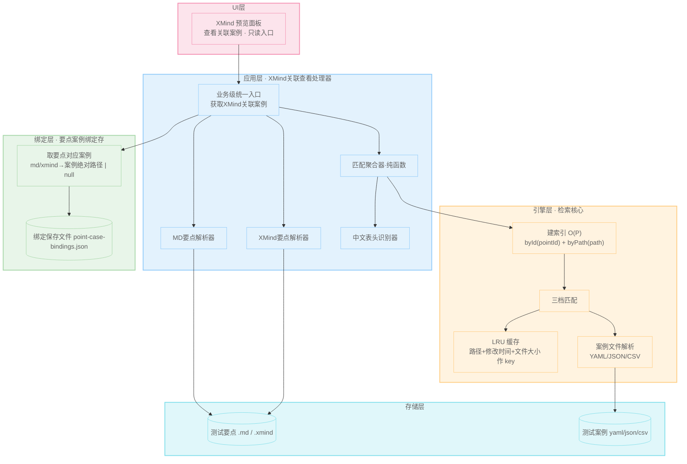
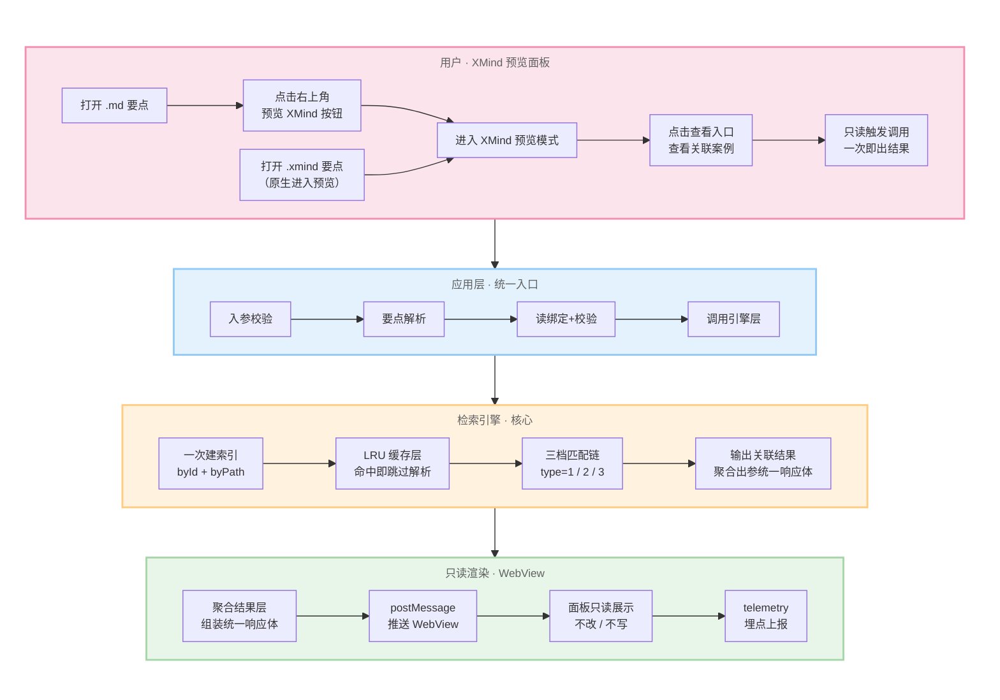
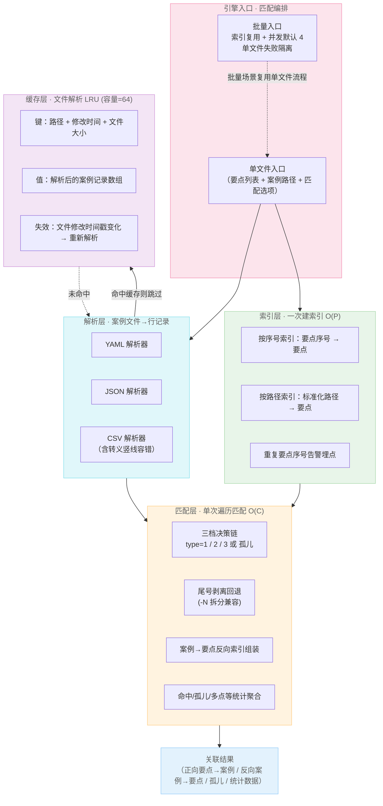
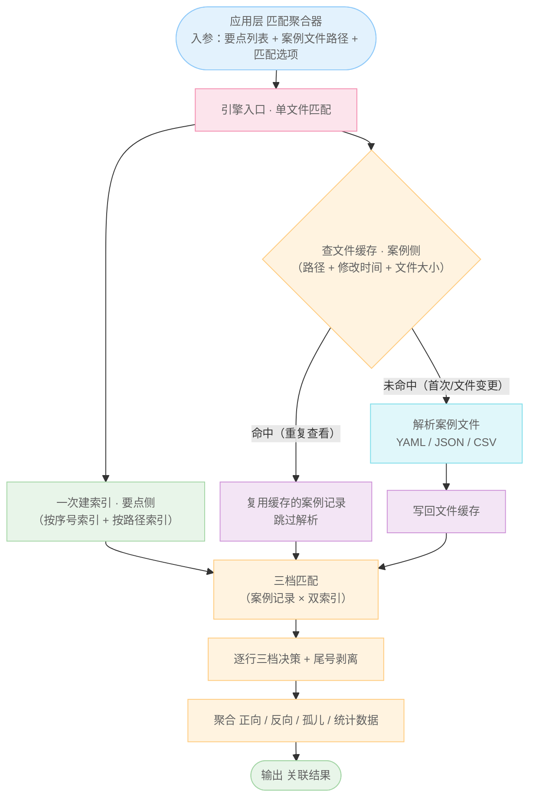
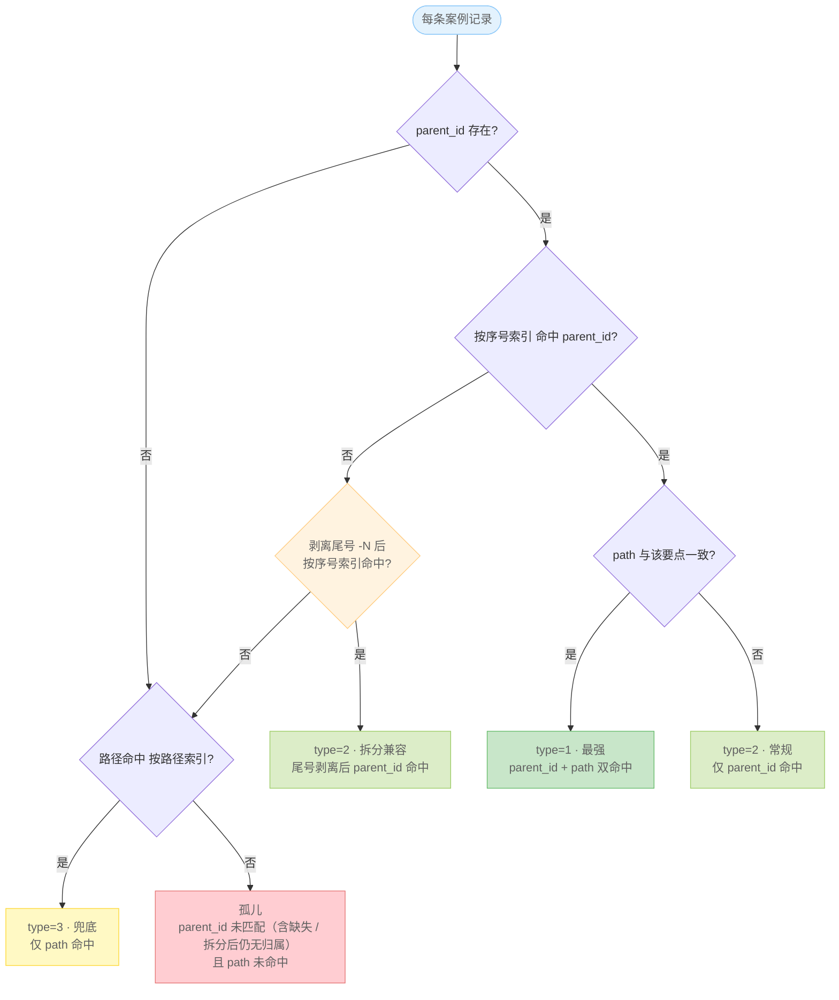
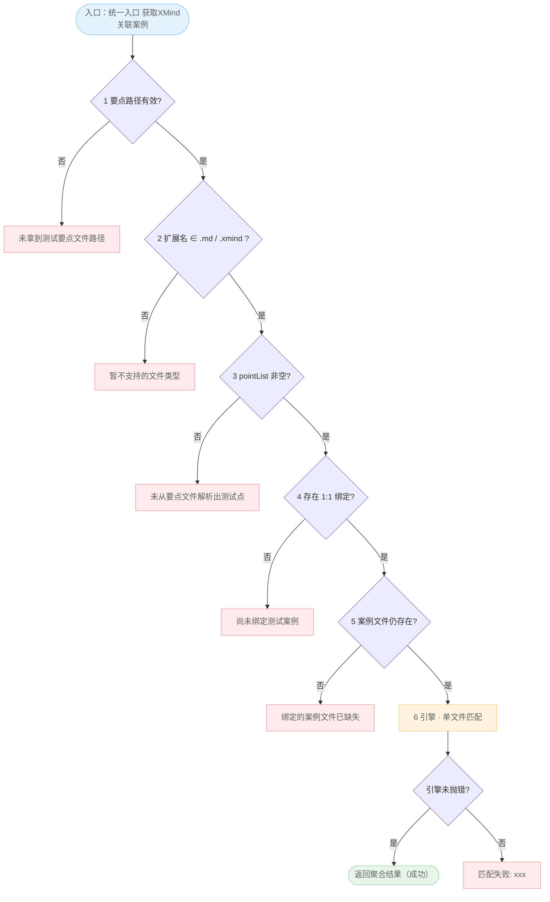
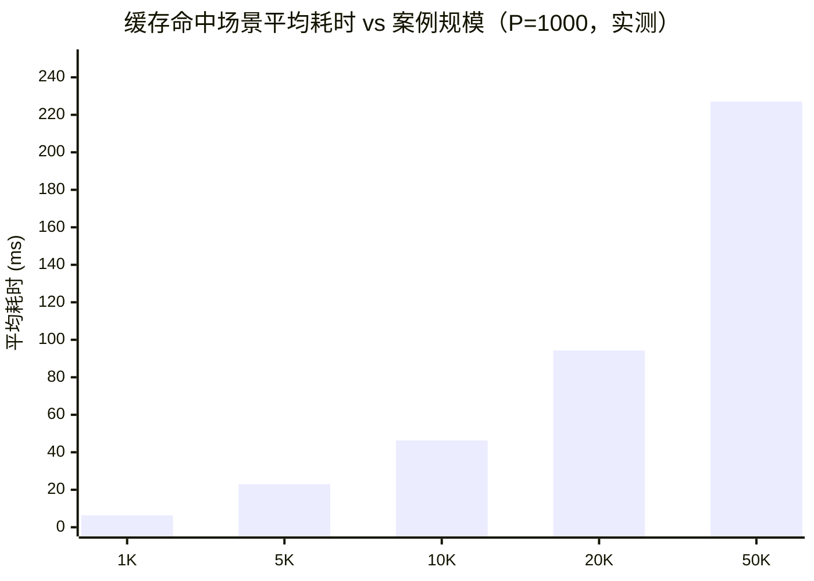
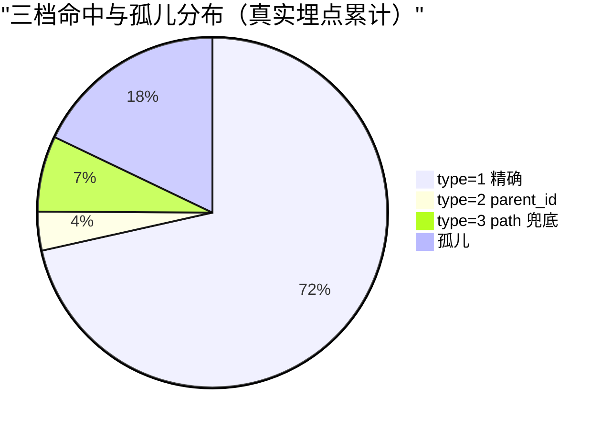

# 基于测试任务插件的测试要点⇄测试案例高性能关联检索方案

## 一、项目背景

TestAgent生成的测试要点（.md/.xmind）与测试案例（.yaml/.json/.csv）通过要点侧pointId（序号）/path（要点路径）与案例侧对应的parent_id/path双字段建立关联，但缺乏结构化检索手段——关联查询都只能靠人工逐条核对。

**核心诉求：海量数据下能否一键、秒级、准确地查到关联关系？** 当前存在三个痛点：

1. **数据量一大就慢**：案例数常达要点十倍以上。
2. **匹配问题识别难**：只得"命中/未命中"粗结果，错在路径、序号还是无案例只能肉眼翻查。
3. **边界情况总遗漏**：要点拆子项、序号重号、孤儿案例等场景易漏。

本项目依托**测试任务插件**（TestAgent工作台）的"测试任务/测试大纲/测试案例"资产体系，构建**高性能关联检索引擎**，将关联核对从"分钟级人工遍历"降为"秒级即时查询"。

## 二、技术方案

本方案依托测试任务插件运行：插件提供**XMind预览面板**、工作区目录约定（要点与案例分别归于 测试任务/<任务名>/测试大纲/、测试任务/<任务名>/测试案例/）与**插件运行环境**（引擎、缓存、索引均在此内存运算，无外部服务依赖），在 XMind 预览模式下查看要点与案例的关联关系；引擎层解决检索算法与性能，上层负责编排与展示。

### 2.1、整体链路与引擎架构

本节自顶向下依次展开整体链路、引擎剖面、入口边界与一致性保障。

#### 2.1.1、整体链路（静态依赖 + 动态时序）

由**查看关联案例**入口触发，以 .md/.xmind要点文件为源，**只读**输出关联结果。分层结构如下：

**静态依赖视角**如上；**动态时序视角**如下，仅画正常路径。

**图注**：应用层以路径正则 + 扩展名硬校验拦截非法输入并确保案例文件存在。

#### 2.1.2、检索引擎架构（引擎层内部剖面）

本节聚焦**引擎层内部**，从四个视角依次展开：

| 主题           | 内容概要                      | 核心问题                   |
| -------------- | ----------------------------- | -------------------------- |
| 静态拓扑       | 五个模块的组成与依赖          | 引擎由哪些模块构成         |
| 动态数据流     | 一次匹配调用如何在模块间流转  | 各模块如何协作流转         |
| 运行时数据结构 | 内存中的核心Map/LRU布局       | 运行时内存中有哪些核心结构 |
| 匹配决策链     | 三档决策 + 尾号剥离的判定路径 | 命中/未命中如何逐级判定    |

**静态拓扑视角**（引擎构成）：

**动态数据流视角**（引擎内部单次检索）：

**运行时数据结构**（引擎层内存视图）：

| 结构               | 类型                                  | 生命周期         | 作用                                                            |
| ------------------ | ------------------------------------- | ---------------- | --------------------------------------------------------------- |
| byId               | Map<pointId, PointItem>               | 单次调用         | O(1) 精确匹配parent_id（含尾号剥离fallback）                    |
| byPath             | Map<normalizedPath, PointItem>        | 单次调用         | O(1) 按路径兜底匹配                                             |
| fileCache          | LRU<key, RowRecord[]>                 | 进程级（cap=64） | 复用文件解析结果，mtime（修改时间）+size（文件大小）双校验失效  |
| RowRecord          | { parent_id, path, __raw }            | 单次调用         | 标准化后的案例记录，供匹配层消费                                |
| LinkResult.byPoint | Map<pointKey, HitCase[]>              | 出参             | 正向：某要点关联的所有案例                                      |
| LinkResult.byCase  | Map<caseKey, {pointKey, type: 1/2/3}> | 出参             | 反向：某案例命中哪个要点（caseKey = 案例路径 + '#' + 记录行号） |
| LinkResult.stats   | MatchStats                            | 出参             | 命中分布、孤儿数、尾号剥离次数、多点命中等治理信号              |

**匹配决策链**（匹配层三档决策 + 尾号剥离）：

**引擎架构的关键设计**：索引与解析解耦、缓存对上层透明、运行时仅5张Map/1个LRU且全O(1)、匹配层为纯函数。

#### 2.1.3、入口只读边界（三道守卫）

**三道守卫**确保"查看关联案例"仅在本插件资产体系内运行、且不会误改源文件：

- **入口守卫**：入口仅在XMind预览面板内可点击，运行于测试任务插件的WebView上下文；
- **目标守卫**：从预览面板取到要点文件后，校验其路径必须命中 测试任务/<任务名>/测试大纲/xxx.(md|xmind) 正则，锁定测试任务插件资产；
- **行为守卫**：面板不提供修改案例、不提供保存回写的能力（要点改名/改路径的回写能力由XMind预览模式承担，与本功能解耦），看到的永远是引擎当前视图。

三道守卫把"对无关文件误触发关联"与"查看过程中误改源文件"两类风险在入口处一并拦截。

#### 2.1.4、数据一致性保障（1:1持久化 + 并发防覆盖）

- **1:1持久化格式**：以**相对路径 + 统一斜杠分隔符（/）**写入插件工作区 .plugin/.tms/point-case-bindings.json，跨平台稳定，仓库克隆到任意机器都能直接使用；
- **1:1数量约束**：**写入接口**若传入 >1个案例直接抛错，从源头保证1:1建模的完整性，杜绝上层业务误传导致的绑定膨胀；
- **并发防覆盖**：多窗口并发写入时，以**文件修改时间戳（mtime）作为版本号**做**写入前校验**——写入前二次读取mtime，若与读取时快照不一致则判定冲突并**自动重试**（上限N次，超出后返回冲突错误由上层提示重试），避免后写覆盖先写。

### 2.2、亮点一：高性能检索（算法 + 缓存）

#### 2.2.1、算法复杂度优化：双哈希索引 + 单次遍历

引擎的检索核心由两步构成：

**① 一次建索引（**索引层**，O(P)）**
进入匹配前，对全部要点列表一次性构建两张哈希表：**按序号索引**（要点序号→要点）与**按路径索引**（标准化路径→要点）。后续每条案例的查找都是 **O(1) 哈希命中**，而非逐条线性比对。

**② 单次遍历匹配（**匹配层**，O(C)）**
对每条案例记录只走一遍决策链：

- type=1：parent_id与path同时精确命中（最强，对应背景痛点2中"双字段正常关联"）
- type=2：仅parent_id命中（含 -N尾号剥离回退，兼容拆分场景；对应"路径错"）
- type=3：仅path兜底命中（兼容无序号要点；对应"序号错"）
- 二者皆否 → 记为孤儿案例（对应"彻底没案例"）

由于索引是哈希查表，**整体复杂度仅O(P) + O(C)**，与朴素双重循环O(P×C) 的暴力比对相比呈数量级下降，这正是**万级案例仍能100毫秒以内返回**的根因。

#### 2.2.2、三层缓存：让大批量数据的重复查看趋近零开销

针对编辑器高频重入（刷新、推送、重复查看）场景，引擎内置三处独立缓存，让大数据文件几乎零重复解析：

- **引擎层文件解析缓存（重头戏）**：键 = 路径 + 修改时间 + 文件大小，容量64。案例文件未变时直接复用解析结果、重复查看近乎零成本；案例一保存（修改时间变）即自动失效重解析。
- **绑定层根目录缓存**：按工作区根目录缓存整份绑定JSON，以修改时间校验失效。
- **绑定层全局绑定表**：装饰器O(1) 查询、内存缓存5秒（写入即失效），应对高频刷新。

三处缓存均以**文件修改时间戳**作为失效判据，因此"**保存即生效**"：

| 改动来源                | 触发刷新 | 说明                       |
| ----------------------- | -------- | -------------------------- |
| 编辑器内改动未保存      | 否       | 修改时间未变，命中缓存旧值 |
| 编辑器保存/外部工具改动 | 是       | 修改时间变更，自动重解析   |

### 2.3、亮点二：真实数据兼容性（中文表头识别 + 脏数据治理）

#### 2.3.1、中文表头自动识别

针对中文CSV模板，应用层的**中文表头识别器**只扫首行 ≤8KB，识别**名称/路径/用例编号/要点序号**等常见中文列名，将其对应到**匹配选项**的字段名后再交给检索引擎。

对比其他思路的取舍如下：

| 适配思路                | 引擎改动             | 新列名接入成本     | 本方案是否采用 |
| ----------------------- | -------------------- | ------------------ | -------------- |
| 引擎内做兼容分支        | 高（污染核心）       | 需改引擎并补充单测 | 否             |
| 写入前做数据清洗/预处理 | 中（需维护清洗管道） | 需改清洗脚本       | 否             |
| 应用层自动识别中文列名  | 零                   | 词表加词即可       | 是             |

#### 2.3.2、脏数据治理矩阵

真实资产库中大量存在 parent_id 拆分、path 重复、无序号要点、重复 ID 等边界情况，本方案在引擎内显式处理并结构化输出信号：

| 边界场景            | 症状                            | 本方案处理                               | 输出信号                                                |
| ------------------- | ------------------------------- | ---------------------------------------- | ------------------------------------------------------- |
| 要点拆分（1→N）    | parent_id带-N尾号（如T123-2）   | 尾号剥离回退至T123，仍归入原点（type=2） | 尾号剥离次数（stats.suffixStripCount）                  |
| 无序号要点          | 只有path、缺pointId             | path兜底命中（type=3）                   | type=3命中数（stats.typeCount.type3）                   |
| 孤儿案例            | parent_id与path均未命中任何要点 | 归集到orphan列表                         | 孤儿总数（stats.totalOrphan）                           |
| 重复pointId         | 多个要点共用同ID                | 建索引阶段告警，索引仅保留首个命中       | 埋点：重复要点序号（telemetry: duplicatePointId）       |
| 一案例命中多要点    | 一条案例命中多个要点            | 反向索引显式记录，不误判为孤儿           | 埋点：一案例命中多要点（telemetry: multiHitCase）       |
| 中文CSV无「路径」列 | 全部记录变为孤儿                | 保留成功格式，stats直接暴露              | 孤儿数 == 总记录数（stats.totalOrphan == totalRecords） |

**关键设计**：脏数据不作为异常抛出，而是与正常结果一同返回在stats中，让"覆盖率"由主观判断转为量化指标。

### 2.4、亮点三：全链路错误契约（统一响应体 + 失败短路）

全链路统一返回**统一响应体**（含 总数/错误信息/数据/统计数据 四段）。统一入口（应用层"获取XMind关联案例"调用点）按六步预检执行**失败短路**：入参校验 → 扩展名分派 → 解析要点 → 读1:1绑定 → 案例存在性校验 → 引擎匹配，任一步不满足即立即返回统一响应体（{ 总数: 0, 错误信息, 数据: {} }），不抛异常、不弹UI，调用方只需检查 错误信息 与 总数。

失败短路判定流程如下（红框为短路返回，绿框为成功出口）：

| 步骤 | 校验项                  | 不通过时的错误信息                                     | 通过则进入         |
| ---- | ----------------------- | ------------------------------------------------------ | ------------------ |
| 1    | 要点文件路径有效        | 未拿到测试要点文件路径                                 | 2                  |
| 2    | 扩展名 ∈ {.md, .xmind} | 暂不支持的测试要点文件类型：xxx，当前仅支持 .md/.xmind | 3                  |
| 3    | 要点列表 非空           | 未从要点文件解析出测试点，请检查内容/表头格式...       | 4                  |
| 4    | 存在1:1绑定             | 当前测试要点尚未绑定测试案例，请选择文件右键绑定后再试 | 5                  |
| 5    | 绑定的案例文件仍存在    | 绑定的测试案例文件已缺失                               | 6                  |
| 6    | 引擎调用未抛错          | 匹配失败: xxx                                          | 是（返回聚合结果） |

**表注**：步骤2扩展名硬校验为 .md或 .xmind；.md走MD要点解析器，.xmind走XMind要点解析器，两者共用后续1:1绑定与引擎匹配链路。

**格式要点**：任何路径下都返回**统一响应体**。若**路径**列与parent_id列均缺失，则全部记录归为孤儿，响应体.总数 == 0且**统计数据中孤儿数 == 总记录数**。

## 三、成果展示

**全链路自观测埋点**：下列量化成果均基于统一埋点上报，覆盖使用频次、失败率、三档命中分布、孤儿率与耗时分位。

- **一键秒级查看关联 + 匹配问题图标定位**：在XMind预览模式点击"查看关联案例"，秒级展示某要点文件（.md/.xmind）关联的全部案例；异常匹配以**红/橙图标**在节点上直接标注——🔴 **缺少案例**（orphan）、🟠 **序号匹配失败**（有路径，缺parent_id，type=3）、🟠 **路径匹配失败**（有parent_id，缺path，type=2），正常双命中（type=1）留白，肉眼一秒锁定问题节点。反向关系（案例属于哪个要点）同样可查。
- **大数据量依旧快**：压测重复查看 < 50ms（更窄口径 < 30ms）；LRU + mtime双校验让"案例一保存即生效"，高频重入场景下解析开销趋零。
- **中文模板零改动适配**：中文表头CSV无需改引擎即可命中（type=2备选逻辑兜住），英文/yaml/json回归不受影响，已通过专项单测验证。
- **数据质量可见**：统计实时展示命中分布、孤儿数、重复pointId、多点命中案例，为资产治理提供量化抓手。
- **XMind要点已支持**：测试要点除 .md外已支持 .xmind格式（.md经"预览XMind"进入，.xmind原生打开），解析分支自动分派，思维导图式要点同样可秒级查到案例关联。
- **测试保障**：引擎层19项单测 + 千条案例集成验证（yaml/json/csv）+ 中文CSV兼容专项，全链路可回归。

### 3.1、压测数据（检索性能）

为验证"大批量数据也能快速查到关联关系"，对引擎核心匹配逻辑（**索引层 + 匹配层**，即引擎单文件匹配主链路）做分档压力测试。测试口径：要点数P固定为1000，案例记录数C递增；**缓存命中场景（案例已入LRU缓存、仅做索引+匹配，不含首次文件IO解析）**，单文件单线程，每档跑20次取平均耗时（P50/P95/P99）。

| 案例规模C | 要点数P | 平均耗时  | P50    | P95    | P99    | 备注                |
| --------- | ------- | --------- | ------ | ------ | ------ | ------------------- |
| 1,000     | 1,000   | 6.33 ms   | 5.85   | 10.35  | 10.35  | 千级，毫秒级返回    |
| 5,000     | 1,000   | 22.94 ms  | 21.90  | 30.38  | 30.38  | 五千级              |
| 10,000    | 1,000   | 46.28 ms  | 44.83  | 62.52  | 62.52  | 万级，100毫秒以内   |
| 20,000    | 1,000   | 94.30 ms  | 95.53  | 100.96 | 100.96 | 两万级，1秒以内     |
| 50,000    | 1,000   | 227.08 ms | 221.57 | 269.79 | 269.79 | 五万级，稳定1秒以内 |

**表注**：上述为完整**匹配层**（含 案例→要点反向索引组装、多点命中检测）在缓存命中场景下的实测。耗时随案例量近似线性增长（O(C)），印证哈希索引检索的复杂度优势——即便案例文件达5万条，单次查看关联仍控制在270ms（P95）内，用户体验无明显等待。

**图注**：首次查看需额外叠加文件解析IO（yaml/json/csv解析），随文件体积增长；但因**文件解析缓存**（容量64，键=路径+修改时间+文件大小）缓存解析结果，**同一文件二次及后续查看即进入上表缓存命中区间**，编辑器反复刷新、推送场景近乎零重复解析开销。

### 3.2、与既有方案的横向对比

为让"提升幅度"可量化，将本方案与工程师现行的两类关联核对方式做横向对比：

| 维度                         | 人工肉眼核对          | 自建正则脚本                 | 本方案                     |
| ---------------------------- | --------------------- | ---------------------------- | -------------------------- |
| 万级案例查询耗时（压测口径） | 分钟级（≈10~30 min） | 秒级但需持续维护脚本         | < 50ms（缓存命中）         |
| 中文表头支持                 | 是（但更慢）          | 否（需为每种列名叫法改脚本） | 是（应用层加词即适配）     |
| 覆盖率量化                   | 否（主观判断）        | 部分（需自行加统计代码）     | 是（内建stats + 埋点）     |
| 拆分/别名容错                | 是（但费力）          | 否（边界易漏）               | 是（尾号剥离 + path兜底）  |
| 双向关联（案例→要点）       | 否（需再遍历一次）    | 部分（需重写脚本）           | 是（引擎一次产出反向索引） |
| 高频重入解析开销             | N/A                   | 否（每次全量重跑）           | 是（三层缓存近零开销）     |
| 学习/接入成本                | 高（依赖人力）        | 中（脚本调试）               | 低（预览面板一键）         |

### 3.3、命中质量分布（真实埋点统计）

基于 XMind 预览面板「查看关联案例」的真实使用过程，引擎每次匹配完成后都会上报埋点事件 `pointCaseLinker.done`（含 totalRecords / matchedRecords / orphanRecords / type1 / type2 / type3 / strippedParentIds 字段）。对一段时间内的真实调用累计统计如下（覆盖 36,052 个要点、64,351 条案例记录）：

| 指标                 | 数值   | 说明                                              |
| -------------------- | ------ | ------------------------------------------------- |
| 总案例记录           | 64,351 | 真实埋点累计（pointCaseLinker.done.totalRecords） |
| type=1精确命中       | 44,769 | parent_id与path双命中，最强                       |
| type=2 parent_id命中 | 2,250  | 含-N尾号剥离回退                                  |
| type=3 path兜底      | 4,381  | 无序号要点也能关联                                |
| 孤儿案例             | 11,207 | 约17.4%，需补parent_id/path                       |
| 尾号剥离次数         | 35,784 | 拆分场景自动归一                                  |

三档命中合计 51,400 与埋点 matchedRecords 一致；关联覆盖率 ≈80%，孤儿率 ≈17.4%，差额 ≈1,744 条为同要点内去重记录（已计入总量但未入命中/孤儿），属正常口径差异。尾号剥离 35,784 次在真实数据大量生效，以上均取自真实埋点。

## 四、项目总结

### 4.1、创新性

针对第一章提出的三个痛点，本方案有三项关键设计：

- **匹配度分三档 + 图标一眼定位**：首次把模糊语义匹配转为可量化的**匹配度分档**（type=1/2/3）；并在XMind节点上以**异常图标**分档标注（缺少案例/路径匹配失败/序号匹配失败），让"是否关联、错在哪一步"变为**看图即答**。
- **要点⇄案例双向关联闭环**：同一套引擎与绑定层单次运行即产出"要点→案例"正向索引与"案例→要点"反向索引，让"哪些要点少了案例"与"哪些案例命中哪个要点"两个问题一次查完，无需再次遍历。
- **保存即生效，反复查看不卡顿**：**三层缓存 + 纯函数引擎**的设计，跳过对未修改案例的重复解析；以**文件修改时间**判断是否需要刷新——用户改完保存立即拿到最新结果，未改的文件反复打开近乎零等待。

### 4.2、质量提升

覆盖率由主观判断转为量化指标：真实埋点累计实测**自动关联覆盖率约80%（51,400 / 64,351）、约17.4% 案例（11,207 条）需人工补齐**，三档匹配、要点拆子项、重复序号等边界情况都被自动识别并呈现为可看指标；查看面板全程**只读**，从入口消除误改源文件的风险。

### 4.3、效能提升

单次关联从**分钟级人工比对**降到**毫秒级一键查看**（万级数据 < 50ms），**反复查看依旧秒回**，改完保存即刻刷新；匹配问题定位也从"翻数据核对字段"升级为"**XMind节点异常图标一眼锁定**"，不用再逐条翻记录找错。

### 4.4、难度

难点集中在四个真实场景：

1. **万级数据下依然秒回**——用哈希索引把逐条比对变成一次查表；
2. **中文模板列名叫法不一**——应用层加词识别，不改核心引擎；
3. **多窗口并发编辑不覆盖**——以文件修改时间作版本号，冲突即重试；
4. **边界情况多**——用**尾号剥离 + path兜底**两条回退链路统一归类，避免漏判。

.md与 .xmind两种要点格式共用同一套匹配链路；任何失败情形均以**六步预检 + 统一响应体**收敛为**同一种返回格式**，上层无需为每种错误单独处理。

### 4.5、推广价值

引擎/缓存/反向索引均为纯函数、无UI依赖，可直接迁移到"需求→用例""缺陷→案例""API→用例"等场景，仅需替换解析器/别名词表；**引擎批量并发入口已就绪**（索引只建一次、并发数默认4、单文件失败不影响其余），新场景可直接承接，具备演进为**通用关联检索中台**的能力。

当前为1:1绑定，后续将扩展为 M:N（**一案例可属多要点/一要点可含多案例**）。
